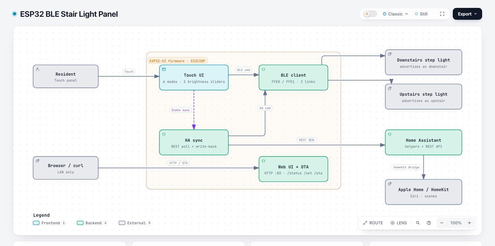

# ESP32 蓝牙楼梯踏步灯中控

**用一块触控屏接管廉价的 BLE 楼梯踏步灯，并接入 Home Assistant 与 HomeKit。**

[English](README.md) · 简体中文

---

这类"楼梯踏步灯"在市面上有十几个牌子，配一个手机 App 和一个 RF 遥控器。
App 难用、遥控器容易丢，而且完全接不进智能家居。

这个项目用一块 2.8 寸 ESP32-S3 触控屏取代 App：

- 主动扫描并同时连接两个控制器（`upstair` / `downstair`）；
- 6 种灯效、两路独立亮度；
- 同步时钟与控制器内置定时；
- 状态双向同步到 Home Assistant，再由 HA 暴露给 HomeKit / Siri；
- 断线自动重连；
- 支持 Wi-Fi OTA。

没有云端、没有厂商 App、没有账号。

[](docs/architecture.html)

> 图片链接到可交互的架构图（`docs/architecture.html`）。

---

## 目录

- [硬件](#硬件)
- [快速开始](#快速开始)
- [手动安装](#手动安装)
- [Home Assistant 配置](#home-assistant-配置)
- [HomeKit](#homekit)
- [Web API](#web-api)
- [BLE 协议](#ble-协议)
- [实现细节](#实现细节)
- [故障排查](#故障排查)
- [兼容性](#兼容性)
- [License](#license)

---

## 硬件

| 部件 | 要求 |
|---|---|
| 主控 | **ES3C28P**：ESP32-S3、16 MB Flash、2.8 寸 320×240 触控屏 |
| 显示/触摸 | ST7789 + CST820（配置在 `include/lgfx_es3c28p.h`） |
| 供电 | 5 V USB |
| 楼梯灯控制器 | BLE 服务 `FFE0`、特征 `FFE1`，广播名 `upstair` / `downstair` |

固件与板卡相关的只有两个文件：`include/lgfx_es3c28p.h`（屏幕/触摸引脚）和
`platformio.ini`（PSRAM 模式）。换板子时改这两处即可。

---

## 快速开始

```bash
git clone https://github.com/syu-lk4b/esp32-ble-stair-light
cd esp32-ble-stair-light
./setup.sh
```

脚本会依次完成：

1. 检查依赖；
2. 询问 Wi-Fi、HA 地址/Token、BLE 设备名、定时时间、可选静态 IP；
3. 编译并烧录；
4. 在局域网里找到设备，打印 BLE 与 HA 状态；
5. 安装 Home Assistant 辅助实体；
6. 可选的冒烟测试（把楼下灯切到"逐步模式"）。

已经刷好固件？

```bash
./setup.sh --skip-flash
```

---

## 手动安装

### 1. 配置

```bash
cp include/secrets.h.example include/secrets.h
$EDITOR include/secrets.h
```

关键字段：

```c
#define WIFI_SSID "your-wifi"
#define WIFI_PASS "your-password"
#define HA_BASE_URL "http://homeassistant.local:8123"
#define HA_TOKEN "eyJ..."
#define BLE_NAME_DOWN "downstair"
#define BLE_NAME_UP   "upstair"
```

HA Token 在 **个人资料 → 安全 → 长期访问令牌** 里创建。

### 2. 编译烧录

```bash
pio run
pio run -t upload
```

### 3. 验证

```bash
curl http://stair-panel.local/status
```

```json
{
  "fw": "1.0.0",
  "ip": "192.168.1.60",
  "ha": true,
  "downstair": { "connected": true, "mode": 3, "bri_step": 79, "bri_flow": 63 },
  "upstair":   { "connected": true, "mode": 1, "bri_step": 79, "bri_flow": 96 }
}
```

`ha` 为 `false` 时检查 URL 和 Token；某个控制器 `connected: false` 时，
先关掉厂商 App，再确认面板在 BLE 范围内。

---

## Home Assistant 配置

### 1. 安装辅助实体

```bash
cp homeassistant/stair_light_package.yaml <ha-config>/packages/stair_light.yaml
```

在 `configuration.yaml` 里启用 packages：

```yaml
homeassistant:
  packages: !include_dir_named packages
```

重启 HA 后会创建：

| 实体 | 类型 | 用途 |
|---|---|---|
| `input_select.downstair_stair_mode` | 下拉 | 模式 0–5 |
| `input_select.upstair_stair_mode` | 下拉 | 模式 0–5 |
| `input_number.downstair_step_brightness` | 数值 | 0–100 |
| `input_number.downstair_flow_brightness` | 数值 | 0–100 |
| `input_number.upstair_step_brightness` | 数值 | 0–100 |
| `input_number.upstair_flow_brightness` | 数值 | 0–100 |
| `input_button.stair_sync_time` | 按钮 | 推送时钟 + 定时 |
| `input_button.stair_ble_reconnect` | 按钮 | 强制重连 BLE |

面板还会通过 REST 上报两个连接状态传感器：

```
binary_sensor.downstair_stair_ble
binary_sensor.upstair_stair_ble
```

HA 重启后 15 秒内会自动重建。

### 2. 仪表盘

`homeassistant/dashboard_card.yaml` 里有一张现成的卡片。

### 3. 同步逻辑

- 面板每 ~800 ms 用 `/api/template` 轮询 HA；
- HA 里的修改会下发到 BLE 控制器；
- 在面板上操作、或按物理遥控器，1 秒内回写到 HA；
- 触摸面板后的 1.2 秒内暂停读取 HA，避免两边互相覆盖。

### 4. 模式字符串

选项值是厂商 App 里的中文，固件与 HA 必须完全一致：

| 值 | 选项 |
|---|---|
| 0 | `0-全亮模式` |
| 1 | `1-交替模式` |
| 2 | `2-流水模式` |
| 3 | `3-逐步模式` |
| 4 | `4-跟随模式` |
| 5 | `5-随机模式` |

改名字的话，`MODE_OPTIONS`、`input_select` 和模板灯三处都要同步改。

---

## HomeKit

HomeKit **不在 ESP32 上实现**。面板只对接 Home Assistant，由 HA 的
**HomeKit Bridge** 把实体发布到 Apple 家庭。

1. 启用可选的模板灯：`homeassistant/template_lights.example.yaml`；
2. 设置 → 设备与服务 → 添加集成 → **HomeKit Bridge**；
3. 勾选 `light.downstair_stair_light` 和 `light.upstair_stair_light`；
4. 用 Apple 家庭扫码配对。

> BLE 协议里没有独立的"开关"命令，只有 6 种模式和两路亮度。
> 模板灯用"台阶亮度 > 0"表示开灯；如果你的控制器不是这个行为，改一下条件即可。

---

## Web API

`http://stair-panel.local/` 提供一个简易控制页。所有接口都支持可选的
HTTP Basic Auth（`WEB_USER` / `WEB_PASS`）。

| 方法 | 路径 | 说明 |
|---|---|---|
| `GET` | `/` | 控制页 |
| `GET` | `/status` | 设备 + BLE + HA 状态 |
| `POST` | `/set?dev=0&mode=3` | 设模式（`dev` 0=楼下，1=楼上） |
| `POST` | `/set?dev=0&bri_step=80` | 设台阶亮度 |
| `POST` | `/set?dev=0&bri_flow=60` | 设流水亮度 |
| `POST` | `/set?dev=0&sync_time=1` | 推送时钟 + 定时 |
| `POST` | `/set?reconnect=1` | 强制重连 |
| `POST` | `/ota` | 上传 `firmware.bin` |

OTA：

```bash
pio run
curl -u admin:****** -F "file=@.pio/build/es3c28p/firmware.bin" \
     http://stair-panel.local/ota
```

---

## BLE 协议

完整逆向文档见 [docs/BLE-PROTOCOL.md](docs/BLE-PROTOCOL.md)，
抓包与中继的完整过程见 [docs/REVERSE-ENGINEERING.zh-CN.md](docs/REVERSE-ENGINEERING.zh-CN.md)
（冒充外设、第一次抓包、命令扫描）。速览：

```
AA AF CMD LEN payload... CHK        CHK = 前面所有字节求和 & 0xFF
```

| CMD | 负载 | 含义 |
|---|---|---|
| `B5` | 模式 0–5 | 灯效 |
| `B9` | 0–100 | 台阶亮度 |
| `B8` | 0–100 | 流水亮度 |
| `BE` | on HH MM off HH MM | 内置定时 |
| `BA` | HH MM SS | 校时 + 查询配置 |

回包：`55 50 BA 10 <16 字节>`，其中 `[11]` 流水亮度、`[12]` 台阶亮度、`[15]` 模式。

---

## 实现细节

### 1. 一块屏，两条 BLE 链路

ESP32 作为 BLE **主机**（central）。`scanAndConnect()` 主动扫描两个广播名，
分别建立连接，两条链路同时保持；断开回调会清空状态，主循环每 10 秒重试。

命令写到 `FFE1`，回包也是同一特征的 notify。写操作用互斥锁串行化，
避免 UI 任务和 HA 任务把一帧数据写串。

### 2. 谁是权威：HA 与本地操作的仲裁

面板和 HA 都会写同一组值，不做仲裁就会无限互相覆盖。面板用了三层保护：

- `lastLocalTouchMs`：触摸后 1.2 秒内不读 HA；
- 每个字段的"上次值"缓存（`haMode` / `haStep` / `haFlow`），只应用真正的变化；
- `pushToHa` 标志，本地变化只回写一次。

### 3. 定时是控制器的，不是 HA 的

`BE 04 HH MM HH MM` 写的是控制器**内置**的定时。按下 `SYNC TIME` 时，
面板会把定时和当前时钟（`BA`）一起推下去。即使 HA 挂了，楼梯灯仍然按点亮。

### 4. UI

LovyanGFX 画 320×240 界面：两个设备页签、6 个模式按钮、两条亮度滑块、
校时/重连按钮。触摸每 25 ms 轮询一次，180 ms 防抖；滑块把 x 坐标映射到 0–100。

### 5. 网络韧性

- Wi-Fi 掉线后每 5 秒重连；
- HA 请求 2.5 秒超时，跑在 core 0 的独立任务里，不阻塞 UI；
- OTA 用第二个 3 MB 分区，升级失败还能重试。

---

## 故障排查

| 现象 | 可能原因 | 处理 |
|---|---|---|
| 两个灯都 `connected: false` | 厂商 App 还连着；BLE 名字不对 | 关掉 App；检查 `BLE_NAME_*` |
| 只连上一个 | 距离太远 / 控制器休眠 | 挪近面板；按一下灯上的按键唤醒 |
| `ha: false` | URL 或 Token 错误 | `curl -H "Authorization: Bearer ..." $HA_BASE_URL/api/` |
| HA 里没有实体 | package 没加载 | 检查 `packages:` 并重启 |
| 模式改完又跳回去 | 选项字符串不一致 | 对齐 `MODE_OPTIONS` 与 `input_select` |
| 屏幕不亮 | 板型/引脚不匹配 | 改 `include/lgfx_es3c28p.h` |
| 触摸位置偏移 | 旋转方向不对 | 调整 `lcd.setRotation()` |
| 网页打不开 | mDNS 不解析 | 用 `/status` 里的 IP |
| OTA 失败 | 分区表不对 | 使用仓库里的 `partitions_ota.csv` |

---

## 兼容性

| 项目 | 状态 |
|---|---|
| ES3C28P（ESP32-S3 + 2.8 寸屏） | ✅ 实测 |
| `upstair` / `downstair` FFE0/FFE1 控制器 | ✅ 实测 |
| 同方案的其他贴牌控制器 | ⚠️ 大概率可用，需确认 GATT UUID |
| 不同 App / 不同协议的控制器 | ❌ |
| Home Assistant 2024.x+ | ✅ |
| Apple 家庭（经 HA HomeKit Bridge） | ✅ |

---

## License

Apache License 2.0，见 [LICENSE](LICENSE)。
